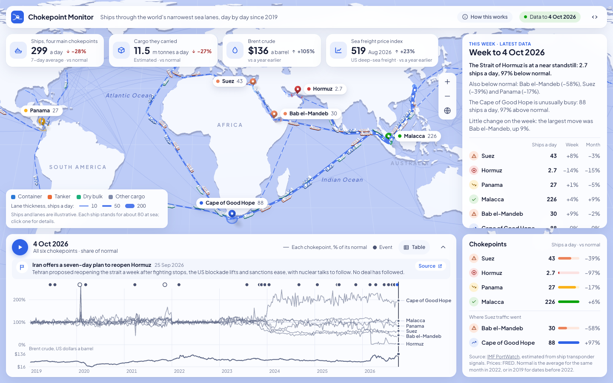

# Chokepoint Monitor

Daily ship transits through the Suez Canal, the Strait of Hormuz, the Panama
Canal and the Strait of Malacca since 2019, on a 3D map with a timeline of the
events that moved them and oil and freight prices alongside. Bab el-Mandeb and
the Cape of Good Hope are included to show where Suez traffic went.

**[See it live](https://benvoliva.github.io/chokepoint-monitor/)**



## What it shows

- **A 3D map** with a pin on each chokepoint, coloured by how far its traffic
  is from normal. Lanes thicken with traffic and ships move along them. Zoom in
  for coastlines, country borders and names.
- **The week in brief.** With nothing selected, a card sums up the latest week
  in a few sentences written from the data, with each chokepoint's change on
  the week and over four weeks.
- **All six compared.** The timeline charts every chokepoint as a share of its
  own normal level, so a canal passing 30 ships a day and a strait passing 200
  sit on one scale.
- **One chokepoint in detail.** Click a pin for its ships a day against normal,
  the cargo carried and the mix of ship types. Click the open map, or press
  Escape, to go back.
- **A timeline of events**, each with a source link, from the Ever Given
  grounding to the Hormuz closure. Drag the chart or press play to move
  through time; Brent crude runs underneath.
- **A table view** of every chart, with the daily figures as a CSV download,
  and a panel explaining the method.

Links can open on a given day and chokepoint, for example
`?date=2021-03-25&focus=suez`.

## Run it locally

The page loads its data with `fetch()`, so it needs a local web server:

```bash
python3 scripts/serve.py
```

Then open http://localhost:8765. No build step and nothing to install; the 3D
library (three.js) and the land outlines load from a CDN.

## Data

| File | What | Source |
|---|---|---|
| `data/transits.json` | Daily transits and estimated cargo by ship type | [IMF PortWatch](https://portwatch.imf.org/) |
| `data/prices.json` | Brent crude (daily) and a deep-sea freight price index (monthly) | [FRED](https://fred.stlouisfed.org/) series `DCOILBRENTEU`, `PCU483111483111` |
| `data/routes.json` | Shipping lanes and the routes ships are drawn along | IMF PortWatch global shipping routes |
| `data/events.json` | Hand-curated events, each with a source link | See the file |

To refresh the first two, run `python3 scripts/fetch_data.py`. `scripts/build_routes.py`
rebuilds the routes and only needs rerunning if the route list changes.

## Things to know about the numbers

- PortWatch counts are estimates from ship transponder (AIS) signals. Ships
  that switch their transponders off are missed, which matters at Hormuz.
- PortWatch publishes weekly, a few days in arrears.
- The ships on the map are illustrative. PortWatch counts transits at each
  chokepoint; it does not track vessels. Each ship drawn stands for about 80
  at sea, and the split of traffic between routes is an assumption.
- "Normal" is the average for the same calendar month in 2022, or in 2019 for
  dates before 2022.
- The weekly summary reports what the counts did. It does not say why; the
  events on the timeline are curated by hand.
